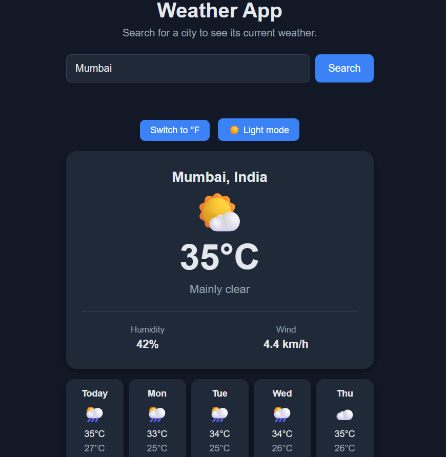

# Weather App

A simple weather app where you search for any city and see its current weather and a 5-day forecast. Built with plain HTML, CSS and JavaScript, using the free [Open-Meteo](https://open-meteo.com/) API (no API key needed).

**Live demo:** [https://cassandrapaiva.github.io/weather-app/](https://cassandrapaiva.github.io/weather-app/)

## Features

- Search any city by name
- Current temperature, conditions, humidity and wind speed
- Weather emoji that match the conditions
- 5-day forecast with daily highs and lows
- °C / °F toggle
- Remembers your last searched city
- Light and dark mode (your choice is saved)
- Loading message and friendly error messages (empty input, city not found, no internet)
- Responsive layout that works on phones

## Built with

- HTML, CSS and JavaScript (no frameworks or libraries)
- [Open-Meteo Geocoding API](https://open-meteo.com/en/docs/geocoding-api) to turn a city name into coordinates
- [Open-Meteo Forecast API](https://open-meteo.com/en/docs) to get the weather
- `fetch` with `async/await` for API calls
- `localStorage` to save the last city, theme preference
- GitHub Pages for hosting

## What I learned

- Making API calls with `fetch` and `async/await`, and working with JSON
- Chaining two API requests (city name, then coordinates, then weather)
- Handling errors with `try/catch` and checking `response.ok`
- Updating the page by building elements with JavaScript
- Saving user preferences with `localStorage`
- Splitting code into small, single-purpose functions

## Run it locally

1. Download or clone this repository.
2. Open `index.html` in your browser.

No installation or API key is needed.
